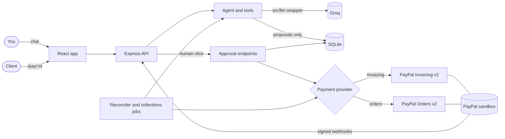

# Chaser

An AI invoicing and collections agent for freelancers and small businesses, built on PayPal for the PayPal x AI hackathon.

You describe the work in plain language or paste an email. Chaser's agent drafts a payment request, you approve it, and PayPal handles the payment. When an invoice goes overdue, the agent drafts an escalating reminder for you to approve, or flags it for you if it looks risky. Nothing leaves Chaser without your click.

**PayPal sandbox only.** The sandbox URL is hard-coded, and the app refuses to start if pointed anywhere else.

## How it works

1. **Describe it.** Type `Bill Acme $2,400 for March brand work, net 15`, or paste a messy email or contract.
2. **The agent drafts it.** It extracts a structured draft. If the amount or client is missing, it asks. The server rejects any amount that isn't in what you wrote.
3. **You approve it.** The draft waits in the approval queue, where you can approve, edit or reject it.
4. **PayPal takes the payment.** You get a link and a message to copy. Chaser doesn't send email or SMS.
5. **Status updates by itself.** Webhooks update it live, and a reconciler checks PayPal every 60 seconds as a fallback.
6. **Overdue invoices get chased.** Code picks the tier from the due date (1-7 days friendly, 8-21 firm, 22+ final notice) and the AI writes the text. Risky cases get flagged for you instead.
7. **Everything is logged.** The decision log shows each decision and why.

## Architecture



### Payment modes

`PAYMENT_PROVIDER` chooses the mode. The dashboard banner shows which is active and why.

| Mode | How it works |
|---|---|
| `auto` (default) | At startup, tries to create a draft invoice and then deletes it. If that works, it uses `invoicing`. A 403 falls back to `orders`. |
| `invoicing` | PayPal Invoicing v2. PayPal hosts the invoice and payment page. Needs the Invoicing feature on the sandbox app. |
| `orders` | PayPal Orders v2. Chaser hosts `/pay/:id`, sends the buyer to PayPal to approve, then captures on return. Needs no extra permission. |

### Safety rules in code

- **Approval gate:** the agent's tools only create proposals, and none of them can send. Sending happens only through the approval endpoints.
- **Stale or repeated approvals:** Approve carries the draft's revision, so it's refused if the draft has changed. An approval can only be claimed once.
- **No invented amounts:** each line's price or total must appear in what the user typed.
- **Prompt injection:** pasted text and stored notes are labelled as data. Tool arguments are validated on the server (USD/EUR/GBP only, amount limit, line item limit). Reminder text can't state any amount but the invoice total, and can't contain links.
- **Paying the right amount:** an invoice is only marked paid if the captured amount and currency match. Anything else is flagged for you.
- **No double charges:** an invoice has one live order, and captures use a fixed PayPal request ID.
- **Webhooks:** every event must pass PayPal's verify-webhook-signature API, and processed event IDs are stored so repeats do nothing.
- **Overdue status:** always calculated from the due date, never taken from a webhook.

## Run it locally

You need Node.js 20.12 or newer, plus the credentials described below.

### Windows (PowerShell)

```powershell
git clone <your-repo-url> chaser
cd chaser
npm install
Copy-Item .env.example .env
notepad .env
npm run build
npm run seed
npm start
```

### macOS / Linux

```bash
git clone <your-repo-url> chaser
cd chaser
npm install
cp .env.example .env
nano .env
npm run build
npm run seed
npm start
```

Then open <http://localhost:3000>.

At minimum, set `PAYPAL_CLIENT_ID`, `PAYPAL_CLIENT_SECRET`, `GROQ_API_KEY` and `GROQ_MODEL` in `.env`.

### Development mode

`npm run dev` runs the API on port 3000 and the Vite dev server with hot reload on <http://localhost:5173>. For payment returns to reach the dev frontend, set `PUBLIC_BASE_URL=http://localhost:5173` in `.env`.

## Get PayPal sandbox credentials

1. Log in at <https://developer.paypal.com/dashboard/>.
2. Under **Testing Tools > Sandbox Accounts**, create a **US-based Business** account and a **US-based Personal** account. The Personal account is your test buyer. Accounts registered in India can't send invoices to customers in India (`INR_FOREIGN_CURRENCY_BLOCKED`), and that's what we hit in testing.
3. Under **Apps & Credentials**, select **Sandbox** and create an app linked to the Business account.
4. Copy its **Client ID** and **Secret** into `.env`.
5. The **Invoicing** feature on the app is optional. If your app gets a 403, Chaser uses Orders mode and everything still works.

## Get a Groq key

Create a key at <https://console.groq.com/keys> and choose a model from <https://console.groq.com/docs/models>. The model must support tool use. Groq's docs list `openai/gpt-oss-20b` and `llama-3.3-70b-versatile` as production models. Chaser has no built-in default, so `GROQ_MODEL` is required.

## Test the payment flow as the sandbox buyer

1. On the **Agent** page, send `Bill Acme $25 for a test, net 15`.
2. Click **Approve and send** on the draft.
3. Click **Open payment link**, or paste the copied link into a private browser window.
4. Click **Pay with PayPal** and log in as your sandbox **Personal** account. Find its password under Sandbox Accounts.
5. Approve the payment. You return to a success page, and the invoice shows as paid.

Seeded demo invoices are local records and can't be paid. Use one created through the agent.

## Webhooks

Webhooks are optional, because the reconciler checks PayPal every 60 seconds.

1. Get a public URL. Locally, use a tunnel such as `ngrok http 3000` or `cloudflared tunnel --url http://localhost:3000`.
2. In your sandbox app under **Webhooks**, add `https://<public-host>/api/webhooks/paypal`.
3. Subscribe to these events:
   - `PAYMENT.CAPTURE.COMPLETED`, `PAYMENT.CAPTURE.PENDING`, `PAYMENT.CAPTURE.DENIED`, `PAYMENT.CAPTURE.DECLINED`, `PAYMENT.CAPTURE.REFUNDED`, `PAYMENT.CAPTURE.REVERSED`
   - `CHECKOUT.ORDER.APPROVED`
   - `INVOICING.INVOICE.PAID`, `INVOICING.INVOICE.CANCELLED`, `INVOICING.INVOICE.REFUNDED`, `INVOICING.INVOICE.UPDATED`
4. Copy the webhook ID into `PAYPAL_WEBHOOK_ID` and restart.

PayPal's docs say simulator events can't be verified through the signature API, so Chaser rejects them with a 400. Test with a real sandbox payment.

## Environment variables

| Variable | Required | Default | Purpose |
|---|---|---|---|
| `PAYPAL_CLIENT_ID` | Yes | | Sandbox app client ID |
| `PAYPAL_CLIENT_SECRET` | Yes | | Sandbox app secret |
| `PAYPAL_WEBHOOK_ID` | For webhooks | | Needed to verify events |
| `PAYMENT_PROVIDER` | No | `auto` | `auto`, `invoicing` or `orders` |
| `PAYPAL_BASE_URL` | No | | Must be unset or the sandbox URL |
| `LLM_PROVIDER` | No | `groq` | `anthropic` is a stub that says it's not configured |
| `GROQ_API_KEY` | Yes | | Groq API key |
| `GROQ_MODEL` | Yes | | Groq model ID |
| `LLM_BACKOFF_BASE_MS` | No | `1000` | Base wait when rate limited |
| `PORT` | No | `3000` | Server port |
| `PUBLIC_BASE_URL` | When hosted | `http://localhost:PORT` | Used in pay links and PayPal return URLs |
| `RENDER_EXTERNAL_URL` | No | | Set by Render, and used if `PUBLIC_BASE_URL` isn't set |
| `ADMIN_PASSWORD` | When hosted | | HTTP Basic password for the dashboard, with any username |
| `DATABASE_PATH` | No | `data/chaser.sqlite` | SQLite file |
| `NODE_ENV` | No | `development` | `production` disables dev tools |
| `SEED_DEMO` | No | | `true` seeds demo data when the database is empty |
| `DEV_TOOLS` | No | | `true` enables simulate-paid, outside production only |
| `MAX_INVOICE_AMOUNT` | No | `100000` | Largest invoice total |
| `MAX_LINE_ITEMS` | No | `20` | Most line items on an invoice |
| `LARGE_AMOUNT_THRESHOLD` | No | `10000` | At or above this, flag for a human |
| `VERY_OVERDUE_DAYS` | No | `60` | At or above this, flag for a human |
| `RECONCILE_INTERVAL_SECONDS` | No | `60` | How often to check PayPal |
| `COLLECTIONS_INTERVAL_MINUTES` | No | `60` | How often to run collections |

## Scripts

| Command | What it does |
|---|---|
| `npm run dev` | API and frontend with reload |
| `npm run build` | Builds the server and frontend into `dist/` |
| `npm start` | Runs the built app |
| `npm test` | Runs the tests. The LLM and PayPal are mocked, and `.env` is never read. |
| `npm run seed` | Replaces demo invoices with fresh ones. Real invoices are left alone. |
| `npm run typecheck` | Type-checks the server, tests and frontend |

## Deploy to Render

1. Push the repo to GitHub.
2. In Render, choose **New > Blueprint** and select the repo. Render reads `render.yaml`.
3. Enter the values it asks for: `ADMIN_PASSWORD`, `PAYPAL_CLIENT_ID`, `PAYPAL_CLIENT_SECRET`, `PAYPAL_WEBHOOK_ID`, `GROQ_API_KEY`, `GROQ_MODEL`.
4. After it deploys, point the sandbox webhook at `https://<your-app>.onrender.com/api/webhooks/paypal`.

**SQLite is ephemeral on Render.** The database is lost on each deploy or restart, and `SEED_DEMO=true` re-creates the demo data. Invoices created through the agent don't survive a restart. This suits a demo, but not production.

## Known limitations / not verified

[PROGRESS.md](PROGRESS.md) records what was run for real against the sandbox.

### Not run end to end yet

These are covered by tests with mocks, but haven't run against the real services:

- **Real signed webhooks.**
- **Invoicing mode's send, remind and cancel.** The test app doesn't have Invoicing permission.
- **Refund events** and **real Groq rate limits**.

### Not confirmed by PayPal's docs

I checked the official docs before coding, but these details weren't visible on the pages I could read. The code handles them defensively.

- **Invoicing status values:** the docs I could read only show `DRAFT`. The other statuses Chaser recognises come from memory. An unknown status stays open, so it can't mark an invoice paid.
- **Invoicing send response:** the difference between 200 and 202 and the response body aren't documented on those pages. Chaser reads the link from `detail.metadata.recipient_view_url`, as shown in an example.
- **Remind and cancel bodies:** the docs mention both a flat body and a `notification` object. Chaser sends the flat form shown in the docs' cURL example.
- **Sending an invoice with no recipient email:** whether PayPal accepts this wasn't confirmed.
- **Orders capture response:** the docs I could read didn't show this in full. A real sandbox payment has since confirmed the path to the capture details (`purchase_units[].payments.captures[]`) and the `COMPLETED` status. The other capture statuses are still unconfirmed.
- **Order status values:** only seen in examples, not as a full list.
- **`ORDER_ALREADY_CAPTURED` and other capture error codes:** seen only in a summary of the errors page.
- **Webhook payloads:** the location of the invoice ID in invoice events isn't shown, so Chaser checks two places and re-reads the invoice from PayPal. `custom_id` on capture events isn't documented, so it's only a fallback after the order ID.
- **Verification result:** the docs only show `SUCCESS`. Anything else is treated as a failure.
- **Denied captures:** the docs list both `PAYMENT.CAPTURE.DENIED` and `PAYMENT.CAPTURE.DECLINED`, so both are handled.

### Not confirmed by Groq's docs

- **Error shapes:** `json_validate_failed` and `tool_use_failed` weren't on the pages read. Chaser retries if it sees them. Otherwise they surface as a normal error.
- **`finish_reason` values:** only `stop` was seen. Chaser doesn't rely on them.

### Not confirmed for Render

`render.yaml` and the Render steps were written from general knowledge and haven't been deployed.

### Product limits

- **Partial refunds:** any refund event marks the whole invoice as refunded.
- **Thresholds and currencies:** `LARGE_AMOUNT_THRESHOLD` compares the raw number, with no currency conversion.
- **Amount check:** it needs digits, so "two thousand dollars" makes the agent ask you to confirm. It proves a number was in your text, not that it's the right one, which is why a person still approves every draft.
- **Dates:** overdue days are calculated in UTC, so they can change at a different time from your local midnight.
- **Access:** `ADMIN_PASSWORD` is one shared password, not user accounts. If you don't set it, the dashboard has no login.
- **Public checkout:** `/api/pay/*` has no rate limiting.

## License

See [LICENSE](LICENSE).
